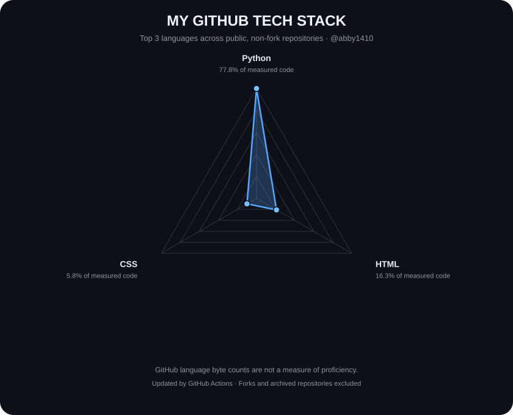

# ABHISHEK KUMAR

### AI PRODUCT BUILDER · PRODUCT THINKER · ENGINEER AT HEART

**I turn messy problems into intelligent products.**

I work at the intersection of AI, software engineering, and product strategy — from identifying the right problem to building, deploying, and improving the solution.

 

  

[Explore My Projects](https://github.com/abby1410?tab=repositories) · [Connect on LinkedIn](https://www.linkedin.com/) · [Email Me](mailto:abhishek14.work@gmail.com)

---

## `$ whoami`

I'm a Product Manager at HighRadius and an IIT Roorkee graduate.

I enjoy the space where **technical depth meets product judgment**: understanding a problem, designing the system, building the solution, and figuring out whether it actually creates value.

My interests span AI-native applications, multi-agent systems, developer tools, workflow automation, and products that turn complex processes into simple experiences.

I don't want to stop at writing PRDs about what AI could do. I want to understand how it works, build it, test its limits, and ship something useful.

## `$ what_i_build`

<table>
<tr>
<td width="50%" valign="top">

### 🧠 AI-Native Products

Applications where AI is central to the experience, not just a chatbot bolted onto a dashboard.

- LLM-powered workflows
- Retrieval-augmented generation
- Evaluation and reliability
- Human-in-the-loop systems

</td>
<td width="50%" valign="top">

### 🤖 Agentic Systems

Systems that break down tasks, use tools, coordinate work, and verify their results.

- Multi-agent architectures
- Tool calling and orchestration
- Planning and task execution
- Observability and evaluation

</td>
</tr>
<tr>
<td width="50%" valign="top">

### ⚙️ Product Engineering

Turning an idea into an application someone can actually use.

- Full-stack prototyping
- APIs and data pipelines
- Database design
- Deployment and iteration

</td>
<td width="50%" valign="top">

### 📈 Product & Business

Making sure the technology solves a real problem.

- Problem discovery
- Product strategy
- Metrics and experimentation
- Workflow and process automation

</td>
</tr>
</table>

## `$ selected_work`

> I value working software over impressive-sounding project descriptions. This section should showcase real projects, their architecture, and what they accomplish.

### 01 — AI Products

**Building useful applications with AI at the core.**

Explore my repositories for experiments in AI-powered applications and product development.

[Browse AI Projects →](https://github.com/abby1410?tab=repositories)

### 02 — Agentic Systems

**Exploring how AI systems can move beyond generating answers to completing tasks.**

My focus is on tool use, task orchestration, verification, and making autonomous workflows reliable.

[Browse Engineering Projects →](https://github.com/abby1410?tab=repositories)

### 03 — Product Engineering

**From a rough idea to a working product.**

I enjoy prototyping interfaces, connecting backends, modelling data, and turning ambiguous requirements into usable software.

[Explore All Repositories →](https://github.com/abby1410?tab=repositories)

---

## `$ my_technical_footprint`

The technologies below are intended to reflect the tools I work with and the systems I build. My automatically generated radar chart tracks programming-language usage across my public GitHub repositories.

### How I think about technology

| Layer | Focus |
|---|---|
| AI | LLM applications, agents, evaluation, and retrieval |
| Programming | Python, SQL, and other languages demonstrated in my projects |
| Data | Data processing, analytics, and reliable data pipelines |
| Systems | APIs, integrations, orchestration, and backend architecture |
| Product | User problems, product decisions, metrics, and iteration |
| Delivery | Prototyping, testing, deployment, and continuous improvement |

*The radar measures repository language composition, not proficiency. The capability areas above describe my interests and approach; individual tools should be verified against the projects themselves.*

## `$ engineering_activity`

I care about understanding how things work, not just making the demo look convincing.

That means examining failure cases, questioning assumptions, measuring outcomes, and improving the system until it becomes useful.

## `$ currently_interested_in`

- Building reliable AI agents that can execute multi-step tasks.
- Designing AI products around real user needs rather than technology hype.
- Evaluating LLM applications beyond whether a demo works once.
- Finding opportunities to automate repetitive, high-friction workflows.
- Building small products that can grow into useful businesses.

## `$ let's_build`

Have an interesting problem, an ambitious AI idea, or a project worth building?

I'm always interested in conversations about AI products, agentic systems, product engineering, and turning ideas into working software.

**Reach me:** [abhishek14.work@gmail.com](mailto:abhishek14.work@gmail.com)

*Think clearly. Build relentlessly. Ship things that matter.*

